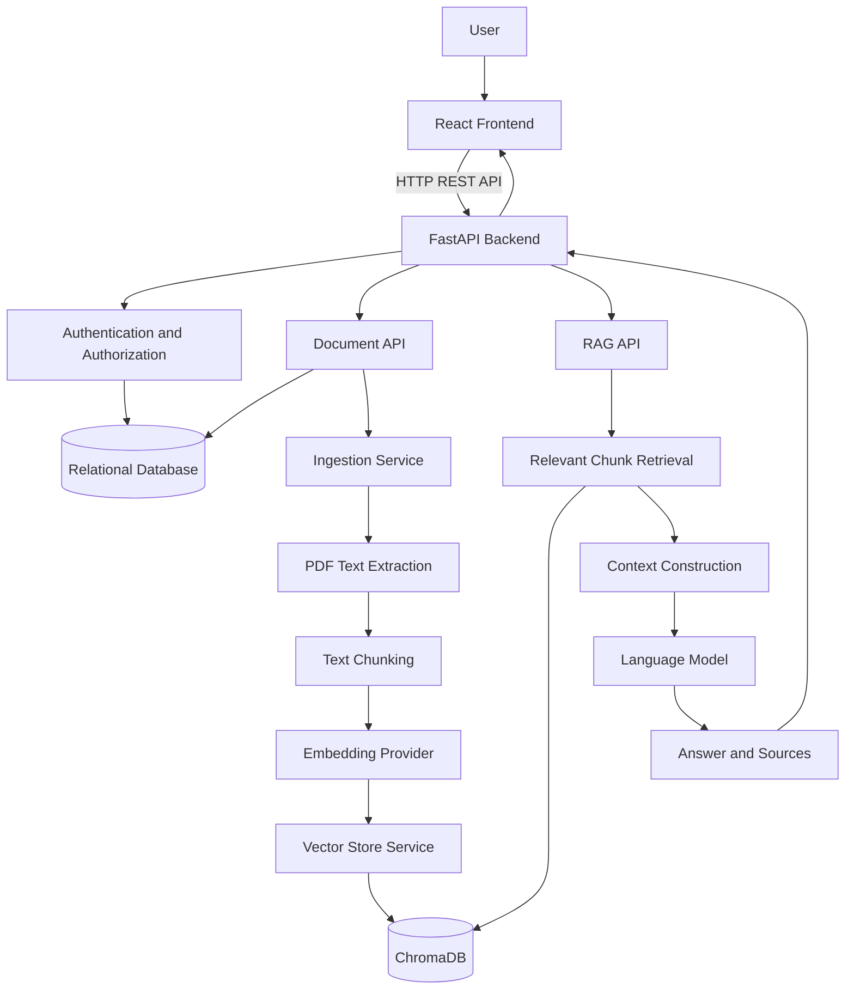

# JANGO — Enterprise Document Intelligence Platform

**An AI-powered document intelligence platform for searching PDF knowledge and generating context-aware answers using Retrieval-Augmented Generation (RAG).**

[GitHub Repository](https://github.com/utkarsh-0106/JANGO-System)

## Overview

JANGO enables users to upload PDF documents and ask natural-language questions about their contents. Instead of passing entire documents to a language model for every question, the system retrieves relevant text passages and supplies them as context for answer generation.

The project combines a React frontend, FastAPI backend, relational persistence, vector search, and configurable AI providers.

## Key Features

- PDF upload, validation, extraction, and text chunking
- Embedding generation and semantic retrieval using ChromaDB
- Retrieval-Augmented Generation for document question answering
- JWT-based authentication and password hashing
- User-scoped document access and vector retrieval
- SHA-256 content-based document deduplication
- Idempotency-key handling for repeated upload requests
- SQLAlchemy-based relational persistence
- Background document ingestion
- Configurable language-model and embedding providers
- Automated backend tests
- Vercel and Render deployment configuration

## Architecture

### Component Responsibilities

Component

Responsibility

React

User interface and document/question interactions

Axios API client

HTTP communication with the backend

FastAPI

Request handling, validation, and API orchestration

Authentication

User identity and endpoint protection

SQLAlchemy

Relational database access

SQLite / PostgreSQL

Structured application and document metadata

Ingestion service

PDF processing, chunking, and indexing

Embedding provider

Converts text into numerical vectors

ChromaDB

Vector storage and similarity search

RAG service

Retrieves context and coordinates answer generation

Language model

Generates natural-language responses

Document Ingestion Workflow

A user uploads a PDF through the frontend.

FastAPI authenticates and validates the request.

The backend checks request idempotency and document content deduplication.

The document record is created or an existing result is reused, as appropriate.

Background ingestion extracts text from the PDF.

Extracted text is divided into overlapping chunks.

An embedding provider generates vector representations.

The vector store indexes the chunks and associated metadata.

The document processing status is updated.

The configured chunking strategy uses approximately 1,000-character chunks with 200-character overlap.

Question-Answering Workflow

The user submits a natural-language question.

The backend authenticates the request.

The RAG service searches for relevant document passages.

Retrieval filters are applied to restrict results to the appropriate user's documents.

Retrieved passages are assembled into context.

The configured language model generates an answer using the question and context.

The API returns the answer and available source information to the frontend.

sequenceDiagram
    actor User
    participant UI as React
    participant API as FastAPI
    participant RAG as RAG Service
    participant DB as ChromaDB
    participant LLM as Language Model

    User->>UI: Ask question
    UI->>API: Submit query
    API->>RAG: Question and user context
    RAG->>DB: Similarity search with filters
    DB-->>RAG: Relevant passages
    RAG->>LLM: Question and retrieved context
    LLM-->>RAG: Generated answer
    RAG-->>API: Answer and source information
    API-->>UI: JSON response
    UI-->>User: Display answer

Duplicate Upload Prevention

JANGO uses two complementary mechanisms.

Request-level idempotency

An idempotency key identifies a logical upload request. Repeated requests with the same key can reuse the existing result rather than creating another document record.

A database uniqueness constraint provides additional protection against concurrent requests using the same key.

Content-level deduplication

SHA-256 generates a hash representing the uploaded file's contents. Identical content can therefore be recognized even when filenames differ.

User-scoped uniqueness constraints help prevent duplicate document records within the intended ownership scope.

Important distinction: Idempotency identifies repeated requests; content hashing identifies repeated file contents. Neither should be assumed to make operations across the database, filesystem, and vector store fully atomic.

Technology Stack

Layer

Technologies

Frontend

React, JavaScript, Vite, Axios

Backend

Python, FastAPI, Pydantic

Database access

SQLAlchemy

Relational database

SQLite locally; PostgreSQL configured for Render

Authentication

JWT, bcrypt

AI orchestration

LangChain

Vector database

ChromaDB

Embeddings

Configurable embedding provider

Language models

Configurable providers, including local or hosted inference

Testing

pytest

Deployment configuration

Vercel, Render

The active AI provider, database, and runtime behavior depend on the project's configuration.

Project Structure

JANGO-System/
├── backend/
│   └── app/
│       ├── main.py
│       ├── api/
│       ├── routers/
│       ├── core/
│       ├── models/
│       ├── services/
│       │   ├── documents.py
│       │   ├── ingestion.py
│       │   ├── rag.py
│       │   └── vector_store.py
│       ├── db.py
│       └── settings.py
├── frontend/
├── render.yaml
└── README.md

This is a simplified architectural overview. Consult the repository for the complete directory structure and active application modules.

Getting Started

Prerequisites

Python

Node.js and npm

Git

A configured relational database

An embedding provider and language-model provider

For local inference, install Ollama and download the models required by your configuration.

1. Clone the Repository

git clone https://github.com/utkarsh-0106/JANGO-System.git
cd JANGO-System

2. Configure the Backend

cd backend
python3 -m venv .venv
source .venv/bin/activate
python -m pip install --upgrade pip
pip install -r requirements.txt

Configure environment variables using the names expected by the backend settings and deployment configuration. Keep API keys, passwords, and signing secrets out of version control.

3. Start the Backend

From the backend directory, if it matches the configured application import path:

uvicorn app.main:app --reload

4. Start the Frontend

Open a second terminal:

cd frontend
npm install
npm run dev

Configure the frontend's backend API URL according to the environment variables used by the frontend.

5. Run Backend Tests

From the backend directory, activate the virtual environment and run:

pytest

The tests that pass depend on the current checkout, environment configuration, and available services.

Deployment

The repository includes deployment configuration for Vercel and Render.

Before deploying, verify:

Database connectivity and persistence

Frontend API URL and CORS configuration

Environment variables and secrets

PDF file and vector-store persistence

AI-provider credentials and model configuration

Background ingestion behavior

Health checks, logs, and error handling

Configuration files describe the intended deployment setup; they do not independently prove that a live deployment is healthy.

Security Considerations

Production deployments should validate:

JWT signing-secret management and token expiration

Password hashing and authentication behavior

Authorization checks for every document access path

User isolation in both SQL queries and vector retrieval

PDF upload size and file validation

Rate limiting and abuse protection

Safe error responses and secret redaction

Persistence and access controls for stored files and vectors

Security guarantees must be confirmed against the implementation and relevant tests.

Engineering Trade-offs

Why RAG?

RAG retrieves relevant document passages before generation. This can reduce unnecessary context and help ground responses in uploaded documents.

Why separate relational and vector storage?

Relational databases manage structured entities such as users, ownership, document status, and uniqueness constraints. A vector database supports similarity search over embedded document chunks.

Why use idempotency and SHA-256?

Idempotency handles repeated logical requests, while SHA-256 supports content-based deduplication. Database constraints add another layer of protection against duplicate records.

Potential Improvements

Durable background job processing

Recovery from partial ingestion failures

Stronger concurrency guarantees

Retrieval evaluation and relevance metrics

Hybrid keyword and semantic search

Reranking of retrieved passages

Rate limiting, observability, and tracing

Expanded failure-path and integration testing

These are possible future improvements, not claims that every capability is currently implemented.

Testing and Quality

Use the existing test suite to validate implemented behavior. Before making production-readiness claims, verify coverage of authentication, document ownership, repeated uploads, concurrent requests, ingestion failures, vector-store errors, and AI-provider timeouts.

Author

Utkarsh Maheshwari

GitHub: https://github.com/utkarsh-0106

Repository: https://github.com/utkarsh-0106/JANGO-System

JANGO — Enterprise Document Intelligence Platform
