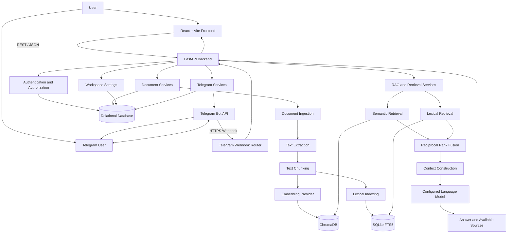

# JANGO 2.0 — Enterprise Document Intelligence Platform

**JANGO** is an AI-powered document intelligence platform that enables users to upload, organize, search, and interact with their documents through natural-language conversations.

Built with **React, FastAPI, SQLAlchemy, ChromaDB, and configurable AI providers**, JANGO combines semantic and lexical retrieval to deliver context-aware answers grounded in uploaded documents.

The platform also includes document lifecycle management, user-scoped retrieval, AI provider configuration, Telegram integration, and personalized workspace settings.

**Repository:** https://github.com/utkarsh-0106/JANGO-System

---

## Table of Contents

- [Overview](#overview)
- [What's New in JANGO 20](#whats-new-in-jango-20)
- [Features](#features)
- [Architecture](#architecture)
- [Core Workflows](#core-workflows)
- [Technology Stack](#technology-stack)
- [Project Structure](#project-structure)
- [Local Development](#local-development)
- [Environment Configuration](#environment-configuration)
- [Telegram Integration](#telegram-integration)
- [Testing](#testing)
- [Deployment](#deployment)
- [Security and Production Considerations](#security-and-production-considerations)
- [Known Limitations](#known-limitations)
- [Documentation](#documentation)
- [Author](#author)

---

## Overview

JANGO provides an end-to-end document intelligence workflow.

Authenticated users can upload supported documents, extract and index their contents, and ask natural-language questions about their data.

The ingestion pipeline extracts document content, creates chunks, generates embeddings, and indexes the resulting representations. At query time, JANGO retrieves relevant information and uses a configured language model to generate context-aware answers.

JANGO 2.0 introduces **Hybrid Retrieval-Augmented Generation (Hybrid RAG)**, combining:

- Semantic retrieval through ChromaDB.
- Lexical retrieval through SQLite FTS5 and BM25.
- Reciprocal Rank Fusion (RRF) to combine retrieval results.

This approach allows the system to retrieve information using both semantic similarity and keyword relevance.

The relational database manages users, document metadata, processing state, workspace preferences, and lexical search data. ChromaDB stores vector embeddings and associated retrieval metadata.

JANGO also supports Telegram integration, allowing linked users to interact with their documents through a Telegram bot.

---

## What's New in JANGO 2.0

JANGO 2.0 focuses on improving retrieval quality, reliability, and document processing.

### 1. Hybrid RAG Retrieval

The retrieval pipeline now combines two complementary search strategies.

**Semantic retrieval**

- Uses embeddings to identify conceptually relevant document passages.
- Retrieves contextually similar content through ChromaDB.
- Helps identify relevant information even when the query uses different wording.

**Lexical retrieval**

- Uses SQLite FTS5 for full-text indexing.
- Uses BM25-based ranking to identify keyword-relevant passages.
- Improves retrieval for exact terms, technical terminology, and specific identifiers.

**Reciprocal Rank Fusion**

The semantic and lexical result rankings are combined using Reciprocal Rank Fusion.

\[
RRF(d)=\sum_{r \in R}\frac{1}{k+\operatorname{rank}_r(d)}
\]

Where:

- \(d\) represents a retrieved document chunk.
- \(R\) represents the retrieval result lists.
- \(k\) is the ranking constant.
- \(\operatorname{rank}_r(d)\) is the position of a chunk in a retrieval list.

This combines results from different retrieval strategies without requiring their raw scores to share the same scale.

### 2. Scoped Lexical Retrieval

Lexical retrieval respects user and document scope.

- Search results are scoped to the relevant user.
- Document-level filtering helps restrict retrieval to the intended document set.
- Lexical retrieval complements the existing user-scoped vector retrieval workflow.

### 3. Lexical Index Backfill

JANGO includes a lexical backfill utility to populate the lexical search index for existing document data.

This supports the introduction of hybrid retrieval without requiring users to discard their existing document collections.

Relevant implementation:

- `backend/app/services/lexical_backfill.py`
- `backend/app/services/lexical_search.py`
- `scripts/backfill_lexical_index.py`

### 4. Document Lifecycle Reliability

The upgraded implementation includes improvements to document processing and failure handling.

- Improved document processing lifecycle handling.
- Better cleanup paths for failed processing operations.
- Additional document service regression tests.
- Improved reliability around indexing and document operations.

### 5. Expanded Regression Testing

The JANGO 2.0 upgrade includes additional tests covering document services, retrieval, and reliability-related behavior.

The upgraded local source passed **95 backend tests** and the frontend production build completed successfully.

---

## Features

### Document Ingestion and Management

- Multi-format document upload and validation.
- Background ingestion for supported document formats.
- Text extraction, chunking, and embedding generation.
- ChromaDB vector indexing.
- Per-user document ownership and retrieval scoping.
- SHA-256 content hashing for duplicate-content detection.
- Idempotency-key handling for repeated upload requests.
- Processing state, timestamps, error details, and ingestion-attempt tracking.
- Retry endpoint for supported failed document-processing jobs.
- Source metadata where available, including PDF pages, slides, sheets, rows, and sections.

### Hybrid Retrieval-Augmented Generation

- Semantic vector retrieval through ChromaDB.
- Lexical full-text retrieval through SQLite FTS5.
- BM25-based lexical ranking.
- Reciprocal Rank Fusion for combining retrieval rankings.
- User-scoped and document-scoped retrieval.
- Retrieval evaluation metrics and evaluation fixtures.
- Context construction from retrieved document passages.
- Source and document information returned where available.

### AI-Powered Document Interaction

- Natural-language document question answering.
- AI-generated summaries.
- Configurable language-model providers.
- Configurable embedding providers.
- Provider and model selection through environment configuration.
- Local inference support through Ollama when the required services and models are available.
- Provider failure handling based on the active configuration.

### Accounts and Persistence

- JWT-based authentication.
- Password hashing.
- FastAPI request validation and API orchestration.
- SQLAlchemy relational persistence.
- Database initialization and schema migration support.
- SQLite for local development.
- Configurable production database.

### Telegram Integration

- Telegram bot integration.
- One-time account-linking codes.
- Authenticated Telegram status and delivery endpoints.
- HTTPS webhook integration.
- Document-related question answering through the backend RAG workflow.
- Supported document delivery and AI-generated content workflows.
- Webhook request verification using a configured secret.

### Workspace Settings

Authenticated users can manage personal workspace preferences.

- Save a default response language: Automatic, English, Hindi, or Hinglish.
- Configure retrieval Top-K values from 1 to 20.
- Use saved Top-K preferences for subsequent Ask Jango queries.
- View the configured primary AI provider and model.
- Change account passwords after verifying the current password.
- Keep provider credentials server-side rather than exposing them through the settings API.

Preferences are stored on the user record.

Existing databases receive backward-compatible defaulted preference columns during application startup. Existing user accounts and documents are preserved.

The Gold & Silver workspace appearance remains fixed.

### Reliability, Testing, and Deployment

- Request idempotency and content-based duplicate detection.
- Document processing lifecycle tracking.
- Failure diagnostics and retry support.
- Automated backend tests using pytest.
- Frontend production builds using Vite.
- Environment-based configuration.
- Vercel frontend and Render backend deployment configuration.
- Architecture, deployment, environment, troubleshooting, and upgrade documentation.

> Actual runtime capabilities depend on the checked-out source, configured environment variables, AI provider, database, storage configuration, and deployment environment.

---

## Architecture



### Component Responsibilities

| Component | Responsibility |
|---|---|
| React + Vite | Web interface for authentication, documents, chat, and settings |
| FastAPI | API routing, request validation, and service orchestration |
| Authentication | User identity and protected endpoint access |
| SQLAlchemy | Relational data access |
| Relational Database | Users, metadata, processing state, and preferences |
| Ingestion Service | Text extraction, chunking, and indexing |
| Embedding Provider | Converts text into vector representations |
| ChromaDB | Vector storage and semantic retrieval |
| SQLite FTS5 | Lexical full-text indexing |
| BM25 Search | Keyword-based relevance ranking |
| Reciprocal Rank Fusion | Combines semantic and lexical rankings |
| RAG Service | Retrieval orchestration and context construction |
| Language Model | Generates answers using retrieved context |
| Telegram Service | Account linking, webhook processing, and bot operations |

---

## Core Workflows

### 1. Document Ingestion

1. An authenticated user uploads a supported file.
2. FastAPI validates the request and checks access rules.
3. The backend applies request idempotency and content-deduplication checks where configured.
4. A document record is created or an existing result is reused as appropriate.
5. The ingestion service extracts text and divides it into chunks.
6. The configured embedding provider generates vector representations.
7. The vector-store service indexes chunks and metadata in ChromaDB.
8. The lexical indexing service maintains the corresponding full-text search data.
9. The document processing state is updated with the outcome and relevant timestamps.

The configured chunking strategy and limits are defined by the active implementation and settings.

### 2. Hybrid Document Retrieval

1. A user submits a natural-language question.
2. The backend identifies the authenticated user.
3. The RAG service initiates the configured retrieval workflow.
4. Semantic retrieval searches relevant embeddings through ChromaDB.
5. Lexical retrieval searches relevant text through SQLite FTS5 and BM25.
6. Retrieved rankings are combined using Reciprocal Rank Fusion.
7. Relevant passages are assembled into context.
8. The configured language model generates an answer.
9. The response and available source information are returned to the originating interface.

### 3. Duplicate Upload Prevention

JANGO uses two complementary mechanisms where configured:

**Request idempotency**

Identifies a logical upload request so repeated requests can reuse an earlier result.

**Content deduplication**

Uses SHA-256 content hashes to detect identical file contents, including files with different names.

These mechanisms reduce duplicate work but do not guarantee atomic writes across the relational database, filesystem, and vector store.

### 4. Lexical Index Backfill

The lexical backfill utility supports populating the lexical index for existing document records.

This helps maintain compatibility with existing document collections when enabling hybrid retrieval.

Refer to `scripts/backfill_lexical_index.py` and the upgrade documentation for the applicable command and configuration.

### 5. Telegram Account Linking and Webhook

1. The authenticated web application requests a link code.
2. The user submits the supported command and code to the JANGO bot.
3. The backend validates the code and associates the Telegram account with the JANGO user.
4. Telegram sends bot updates to the configured HTTPS webhook.
5. The backend verifies the configured webhook secret.
6. Supported questions use the document/RAG workflow.
7. Supported delivery actions use the Telegram Bot API.

Check the current Telegram router and Telegram documentation for the exact webhook path and supported commands.

---

## Technology Stack

| Layer | Technologies |
|---|---|
| Frontend | React, JavaScript, Vite, CSS |
| Backend | Python, FastAPI, Pydantic |
| API | REST/JSON, Telegram webhooks |
| Database Access | SQLAlchemy |
| Relational Database | SQLite locally; configured production database |
| Authentication | JWT, password hashing |
| Document Processing | Format-aware extraction, chunking, background ingestion |
| Vector Database | ChromaDB |
| Lexical Search | SQLite FTS5, BM25 |
| Hybrid Retrieval | Semantic search, lexical search, Reciprocal Rank Fusion |
| AI | Configurable embedding and language-model providers |
| Local Inference | Ollama |
| Telegram | Telegram Bot API |
| Backend Testing | pytest |
| Frontend Build | Vite |
| Deployment Configuration | Vercel, Render |

---

## Project Structure

```text
JANGO-System/
├── alembic/
│   ├── env.py
│   └── versions/
│
├── backend/
│   ├── app/
│   │   ├── main.py
│   │   ├── models/
│   │   ├── routers/
│   │   ├── schemas/
│   │   ├── services/
│   │   │   ├── lexical_search.py
│   │   │   ├── lexical_backfill.py
│   │   │   └── ...
│   │   ├── evaluation/
│   │   ├── db.py
│   │   └── settings.py
│   │
│   ├── tests/
│   └── .env.example
│
├── frontend/
│   └── src/
│       ├── components/
│       └── pages/
│
├── scripts/
│   └── backfill_lexical_index.py
│
├── docs/
│   └── UPGRADE_AUDIT.md
│
├── tests/
│   └── test_settings_security.py
│
├── ARCHITECTURE.md
├── DEPLOYMENT.md
├── ENVIRONMENT_VARIABLES.md
├── TROUBLESHOOTING.md
├── render.yaml
├── requirements.txt
└── README.md
```

This is a representative structure. Consult the repository for all modules and paths.

---

## Local Development

### Prerequisites

- Git
- Python version supported by the repository's runtime/dependency configuration
- Node.js and npm
- A configured relational database
- A configured embedding provider and language-model provider
- Ollama and required models if using local inference
- Telegram bot token only if testing Telegram integration

### 1. Clone the Repository

```bash
git clone https://github.com/utkarsh-0106/JANGO-System.git
cd JANGO-System
```

### 2. Configure and Start the Backend

From the repository root:

```bash
python3 -m venv .venv
source .venv/bin/activate

python -m pip install --upgrade pip
pip install -r requirements.txt
```

Configure the required environment variables.

Start the backend:

```bash
python -m uvicorn app.main:app --reload --app-dir backend --port 8000
```

Backend API:

```text
http://localhost:8000
```

API documentation:

```text
http://localhost:8000/docs
```

### 3. Start the Frontend

Open another terminal:

```bash
cd frontend
npm install
npm run dev
```

Configure the frontend API base URL to point to the backend address used in local development.

Never place private API keys, Telegram bot tokens, or webhook secrets in frontend code.

### 4. Run Backend Tests

From the repository root:

```bash
source .venv/bin/activate
python -m pytest tests backend/tests -v
```

### 5. Build the Frontend

```bash
cd frontend
npm install
npm run build
```

Test and build results depend on the current checkout, installed dependencies, environment configuration, and external services.

---

## Environment Configuration

Use `.env.example` and `backend/.env.example` as references.

Put real values in a local ignored `.env` file or in the deployment provider's environment settings.

| Variable | Purpose |
|---|---|
| `ENVIRONMENT` | Runtime environment |
| `DATABASE_URL` | Relational database connection |
| `SECRET_KEY` | Authentication/signing secret |
| `ALGORITHM` | JWT signing algorithm |
| `ACCESS_TOKEN_EXPIRE_MINUTES` | Token lifetime |
| `CORS_ORIGINS` | Allowed frontend origins |
| `LLM_PROVIDER` | Selected language-model provider |
| `EMBEDDING_PROVIDER` | Selected embedding provider |
| `GEMINI_API_KEY` | Optional Gemini credential |
| `GROQ_API_KEY` | Optional Groq credential |
| `ANTHROPIC_API_KEY` | Optional Anthropic credential |
| `OLLAMA_BASE_URL` | Ollama server URL |
| `OLLAMA_CHAT_MODEL` | Local chat model name |
| `OLLAMA_EMBEDDING_MODEL` | Local embedding model name |
| `CHROMA_PERSIST_DIRECTORY` | Vector-store persistence directory |
| `DOCUMENT_STORAGE_DIRECTORY` | Uploaded-document storage directory |
| `TELEGRAM_BOT_TOKEN` | Backend Telegram Bot API token |
| `TELEGRAM_WEBHOOK_SECRET` | Secret used to verify webhook requests |
| `VITE_API_URL` | Frontend API base URL |

### Important Configuration Notes

- Keep real `.env` files out of version control.
- Use blank values or clearly fake placeholders in example files.
- Never put Telegram bot tokens, webhook secrets, database passwords, or signing secrets in `VITE_*` variables.
- Configure backend secrets in the backend hosting environment.
- Verify variable names against `backend/app/settings.py` and the active deployment configuration.
- Configure the embedding and language-model providers required by your selected retrieval workflow.

---

## Telegram Integration

JANGO supports Telegram-based document interaction through a linked user account.

### Bot Configuration

1. Create or select a Telegram bot.
2. Set `TELEGRAM_BOT_TOKEN` in the backend environment.
3. Generate a long random webhook secret.
4. Set `TELEGRAM_WEBHOOK_SECRET`.
5. Deploy the backend to an HTTPS URL.
6. Register the Telegram webhook using the exact route and secret-header format expected by the implementation.
7. Verify webhook status and inspect backend logs.
8. Link a test account and test supported Q&A and delivery workflows.

### Security Notes

- Never expose the bot token in frontend code.
- Never expose the webhook secret in frontend code.
- The production webhook must target the deployed backend, not a temporary local tunnel.
- Verify webhook authentication before enabling public bot access.

---

## Testing

The JANGO 2.0 upgraded source copy was tested locally after the merge into `main`.

### Latest Verified Results

| Validation | Result |
|---|---:|
| Backend tests | **95 passed** |
| Backend warnings | 50 warnings |
| Frontend production build | Successful |
| Git working tree | Clean |
| GitHub main synchronization | Verified |

The backend test suite completed successfully:

```text
95 passed, 50 warnings
```

The warnings included `datetime.utcnow()` deprecation notices in SQLAlchemy defaults and document ingestion code. These did not cause test failures.

The frontend production build completed successfully using Vite.

### Recommended Production Validation

Before a production release, verify:

- Frontend production build succeeds.
- Backend tests pass.
- Protected endpoints reject unauthenticated requests.
- Document retrieval and delivery respect user ownership.
- Semantic and lexical retrieval return appropriately scoped results.
- Invalid Telegram webhook secrets are rejected.
- AI-provider and Telegram API failures are handled safely.
- Database, uploaded-file, lexical-index, and vector-store persistence work as expected.

---

## Deployment

JANGO includes deployment configuration for:

- **Frontend:** Vercel
- **Backend:** Render

Configuration files do not prove that a deployment is live or healthy. Verify actual service settings, deployment logs, and production behavior.

### Render Backend

Verify:

- Python runtime and dependency installation.
- Production `DATABASE_URL`.
- Strong authentication/signing secrets.
- CORS origins for the deployed frontend.
- AI provider credentials and model settings.
- Telegram bot token and webhook secret, if Telegram is enabled.
- Persistent storage for uploaded files and ChromaDB, or managed alternatives.
- Health checks, logs, and restart behavior.
- Lexical index initialization and backfill requirements when upgrading existing data.

### Background Processing Limitation

Document ingestion currently uses FastAPI in-process background tasks.

Jobs are not durably queued across process crashes. Interrupted jobs are marked failed at startup and can be retried through the supported document retry endpoint.

For multi-instance or high-volume production, use a durable worker queue before scaling beyond a single API instance.

### Storage Limitation

A Render disk can persist document and ChromaDB files for a single service instance when configured.

It is not shared storage for horizontally scaled instances.

Use shared object storage and an appropriate shared vector-store architecture before scaling out.

### Vercel Frontend

- Configure the frontend project root and build command.
- Set `VITE_API_URL` to the deployed backend URL.
- Redeploy after changing environment variables.
- Do not place backend secrets in client-exposed `VITE_*` variables.

---

## Security and Production Considerations

- Use a strong, randomly generated production signing secret.
- Store API keys, bot tokens, and webhook secrets only in backend secret configuration.
- Enforce authorization on every document access and delivery path.
- Scope relational queries and vector retrieval to the authenticated user's documents.
- Apply the appropriate user and document filters to lexical retrieval.
- Validate uploaded files and enforce configured upload limits.
- Avoid logging credentials, passwords, document contents, or sensitive user data.
- Configure restrictive CORS origins and HTTPS endpoints.
- Review rate limiting, provider timeouts, retry behavior, and error logging.
- Confirm database, uploaded-file, lexical-index, and vector-store persistence before relying on production deployments.
- Test account linking, webhook authentication, and user isolation before public release.

Security properties must be verified against the implementation and tests. This README is not a substitute for a security audit.

---

## Known Limitations

- Scanned/image-only PDFs require OCR; OCR is not included in the documented ingestion workflow.
- Legacy binary Word `.doc` and PowerPoint `.ppt` formats are not supported.
- Macro-enabled Office files are not supported.
- Spreadsheet files are indexed as textual content; formula recalculation and exact spreadsheet computation are not provided.
- Image understanding is not part of the documented document-ingestion workflow.
- In-process background tasks are not durable across process crashes.
- Local SQLite, uploaded files, and local ChromaDB data do not automatically migrate to a hosted environment.
- A single-instance persistent disk is not shared storage for multiple backend instances.
- Database, filesystem, and vector-store writes are not guaranteed to be one atomic transaction.
- Production lexical-index migration and backfill should be validated when upgrading existing deployments.

Confirm the exact accepted extensions, file-size limits, and provider behavior against the current code and environment configuration.

---

## Documentation

Additional project documentation:

- [Architecture](ARCHITECTURE.md)
- [Deployment Guide](DEPLOYMENT.md)
- [Environment Variables](ENVIRONMENT_VARIABLES.md)
- [Troubleshooting](TROUBLESHOOTING.md)
- [Upgrade Audit](docs/UPGRADE_AUDIT.md)

---

## Author

**Utkarsh Maheshwari**

- GitHub: https://github.com/utkarsh-0106
- Repository: https://github.com/utkarsh-0106/JANGO-System
- Portfolio: https://portfolio-dqyw-opal.vercel.app

---

**JANGO 2.0 — Enterprise Document Intelligence Platform**

*Hybrid Retrieval. Context-Aware Answers. Reliable Document Intelligence.*
