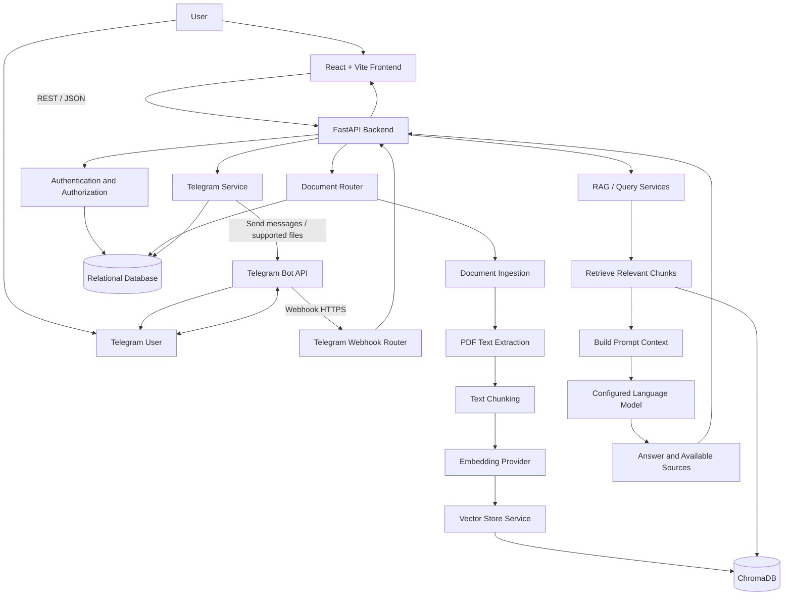
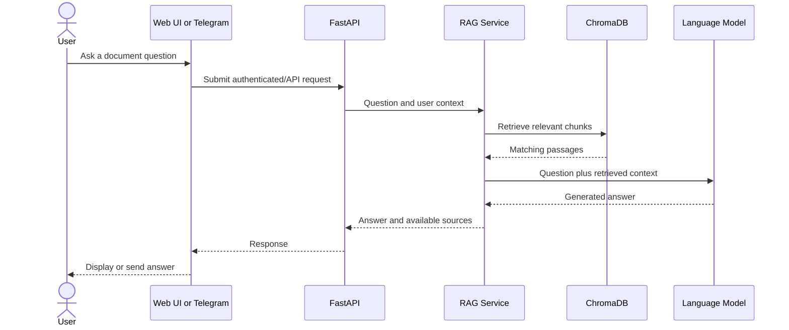

# JANGO — Enterprise Document Intelligence Platform

**JANGO is an AI-powered document intelligence platform for uploading PDFs, searching their contents, and generating context-aware answers with Retrieval-Augmented Generation (RAG). It also supports Telegram account linking, document delivery, and document Q&A through a Telegram bot.**

[GitHub Repository](https://github.com/utkarsh-0106/JANGO-System)

---

## Table of Contents

- [Overview](#overview)
- [Features](#features)
- [Architecture](#architecture)
- [Core Workflows](#core-workflows)
- [Technology Stack](#technology-stack)
- [Project Structure](#project-structure)
- [Local Development](#local-development)
- [Environment Configuration](#environment-configuration)
- [Telegram Integration](#telegram-integration)
- [Testing](#testing)
- [Deployment](#deployment)
- [Security and Production Checklist](#security-and-production-checklist)
- [Engineering Trade-offs](#engineering-trade-offs)
- [Future Improvements](#future-improvements)
- [Author](#author)

## Overview

JANGO lets authenticated users upload PDF documents and ask natural-language questions about their contents. The backend extracts and chunks document text, generates embeddings, indexes chunks in ChromaDB, retrieves relevant passages for a question, and passes that context to a configured language model.

The React frontend communicates with a FastAPI backend. Relational storage holds structured application data and document metadata, while the vector store supports semantic retrieval. Configurable AI providers allow the application to use supported hosted providers or local inference, depending on the environment.

The Telegram integration extends this workflow beyond the web interface. Users can link a Telegram account to their JANGO account, ask document-related questions through the bot, and request supported document deliveries or AI-generated summaries/reports.

## Features

### Document intelligence
- PDF upload, validation, text extraction, and chunking
- Embedding generation and semantic retrieval using ChromaDB
- RAG-based question answering grounded in retrieved document passages
- Source/document metadata returned where available
- User-scoped document access and retrieval
- SHA-256 content-based document deduplication
- Idempotency-key handling for repeated upload requests
- Background document ingestion

### Accounts and persistence
- JWT-based authentication and password hashing
- FastAPI request validation and API orchestration
- SQLAlchemy-based relational persistence
- User and document metadata stored separately from vector embeddings
- SQLite for local development; production database depends on deployment configuration

### AI configuration
- Configurable language-model and embedding providers
- Provider/model selection through environment configuration
- Support for local inference where the required Ollama models are installed
- AI-assisted responses and document summaries where implemented by the configured provider

### Telegram integration
- Telegram bot integration with JANGO
- Account linking using a one-time link code
- Authenticated API endpoints for Telegram status and delivery actions
- Telegram webhook endpoint for incoming bot updates
- Document-related Q&A through Telegram, using the backend's configured AI/RAG workflow
- Supported document delivery and AI-generated summary/report actions from the web application
- Webhook request verification using a configured Telegram webhook secret

### Engineering and deployment
- Automated backend tests with pytest
- Frontend production build using Vite
- Vercel frontend and Render backend deployment configuration
- Environment-based configuration for local and hosted deployments

> The precise capabilities available at runtime depend on the checked-out code, configured environment variables, AI provider, database, and deployment environment.

## Architecture



### Component responsibilities

| Component | Responsibility |
|---|---|
| React + Vite | Web UI for authentication, documents, chat, and Telegram controls |
| API client | Sends HTTP requests to the backend |
| FastAPI | Routes requests, validates inputs, and coordinates application services |
| Authentication | Identifies users and protects authenticated endpoints |
| SQLAlchemy | Relational data access |
| Relational database | Stores users, document metadata, and related application state |
| Ingestion service | Extracts PDF text, chunks content, and initiates indexing |
| Embedding provider | Converts text into vector representations |
| ChromaDB | Stores vectors and supports similarity retrieval |
| RAG service | Retrieves relevant chunks and coordinates answer generation |
| Language model | Generates responses from the question and retrieved context |
| Telegram router | Handles Telegram-related API endpoints and incoming webhook updates |
| Telegram service | Handles bot operations, account-linking flow, and supported message/file delivery |
| Telegram Bot API | Connects the JANGO backend to Telegram chats |

## Core Workflows

### 1. Document ingestion

1. An authenticated user uploads a PDF through the web frontend.
2. FastAPI validates the request and applies the relevant access checks.
3. The backend checks request idempotency and content deduplication where configured.
4. The document record is created or an existing result is reused as appropriate.
5. The ingestion service extracts text and divides it into overlapping chunks.
6. The configured embedding provider creates vector representations.
7. The vector-store service indexes chunks with relevant metadata.
8. The document processing state is updated.

The configured chunking strategy is approximately 1,000 characters with 200 characters of overlap; check the active implementation for the exact behavior.

### 2. Document question answering

1. The user submits a natural-language question in the web app or through a linked Telegram account.
2. The backend identifies the user and determines which documents that user may access.
3. The RAG service retrieves relevant passages from the vector store.
4. Retrieved passages are assembled into context for the language model.
5. The configured model generates an answer.
6. The response is returned through the originating channel, with source information where available.



### 3. Telegram account linking

1. The user opens the Telegram integration in JANGO.
2. JANGO creates a link code through the authenticated backend flow.
3. The user sends the supported link command and code to the JANGO Telegram bot.
4. The backend validates the code and associates the Telegram account with the appropriate JANGO user.
5. The web interface can query the Telegram status endpoint to show the link state.

Link-code expiration, one-time-use behavior, and rate limits should be confirmed against the current implementation and configuration.

### 4. Telegram webhook and delivery

1. Telegram sends bot updates to the configured HTTPS webhook.
2. The backend validates the configured webhook secret header.
3. The Telegram router delegates supported operations to the Telegram service.
4. For supported questions, the backend uses the configured document/RAG and AI-provider workflow.
5. For supported delivery actions, the service sends the selected document or generated content through the Telegram Bot API.

The production webhook must point to the deployed backend, not a temporary local tunnel. Do not expose the bot token or webhook secret in frontend code.

### 5. Duplicate upload prevention

JANGO uses two complementary concepts where implemented:

- **Request idempotency:** an idempotency key identifies a logical upload request so a repeated request can reuse the prior result.
- **Content deduplication:** SHA-256 can identify identical file contents even if filenames differ.

These mechanisms address different cases. They do not by themselves guarantee atomic operations across the relational database, filesystem, and vector store.

## Technology Stack

| Layer | Technologies |
|---|---|
| Frontend | React, JavaScript, Vite, CSS |
| Backend | Python, FastAPI, Pydantic |
| API | REST/JSON and Telegram webhook handling |
| Database access | SQLAlchemy |
| Relational database | SQLite locally; production database according to deployment configuration |
| Authentication | JWT, password hashing |
| Document processing | PDF extraction, text chunking, background ingestion |
| Vector database | ChromaDB |
| Embeddings | Configurable embedding provider |
| Language models | Configurable local or hosted providers |
| Telegram | Telegram Bot API and HTTPS webhook |
| Testing | pytest |
| Frontend build | Vite |
| Deployment configuration | Vercel, Render |

## Project Structure

```text
JANGO-System/
├── backend/
│   ├── app/
│   │   ├── main.py
│   │   ├── api/
│   │   ├── core/
│   │   ├── models/
│   │   ├── routers/
│   │   │   ├── documents.py
│   │   │   ├── query.py
│   │   │   ├── rag.py
│   │   │   └── telegram.py
│   │   ├── schemas/
│   │   ├── services/
│   │   │   ├── documents.py
│   │   │   ├── ingestion.py
│   │   │   ├── rag.py
│   │   │   ├── telegram.py
│   │   │   └── vector_store.py
│   │   ├── db.py
│   │   └── settings.py
│   └── tests/
├── frontend/
│   └── src/
│       ├── components/
│       │   └── TelegramConnectCard.jsx
│       └── pages/
│           ├── Chat.jsx
│           └── Dashboard.jsx
├── docs/
│   ├── TELEGRAM_BOT.md
│   └── TELEGRAM_DOCUMENT_DELIVERY.md
├── tests/
│   ├── test_telegram.py
│   └── test_telegram_delivery.py
├── render.yaml
├── requirements.txt
└── README.md
```

This is a representative structure; consult the repository for all modules and any paths that have changed.

## Local Development

### Prerequisites

- Git
- Python version supported by the repository's runtime/dependency configuration
- Node.js and npm
- A configured relational database
- A configured embedding provider and language-model provider
- For local inference, Ollama and the models required by your configuration
- A Telegram bot token only if testing Telegram integration

### 1. Clone the repository

```bash
git clone https://github.com/utkarsh-0106/JANGO-System.git
cd JANGO-System
```

### 2. Configure and start the backend

From the repository root:

```bash
python3 -m venv .venv
source .venv/bin/activate
python -m pip install --upgrade pip
pip install -r requirements.txt
```

If the repository's backend dependencies are maintained separately, also inspect `backend/requirements.txt` and use the dependency file specified by the deployment configuration.

Configure the environment variables described below. Then start the API using the import path appropriate for the repository layout. For the `backend/app/main.py` layout, this commonly means:

```bash
cd backend
uvicorn app.main:app --reload
```

### 3. Start the frontend

Open another terminal:

```bash
cd frontend
npm install
npm run dev
```

Set the frontend API base URL to the backend address used in local development. The frontend should not contain private API keys, Telegram bot tokens, or webhook secrets.

### 4. Run tests and build

From the repository root, activate the Python environment and run the backend test suite using the project's configured pytest paths:

```bash
python -m pytest -q
```

Build the frontend:

```bash
cd frontend
npm install
npm run build
```

Test results depend on the current checkout, installed dependencies, environment configuration, and available external services.

## Environment Configuration

Use `.env.example` as a starting point and configure the actual values in a local, ignored `.env` file or the deployment provider's environment settings. Variable names below are representative; verify them against `backend/app/settings.py`, the Telegram service, and deployment configuration in the current checkout.

| Variable | Purpose |
|---|---|
| `ENVIRONMENT` | Runtime environment |
| `DATABASE_URL` | Relational database connection string |
| `SECRET_KEY` | Secret used for signing/authentication, if configured by the app |
| `ALGORITHM` | JWT signing algorithm |
| `ACCESS_TOKEN_EXPIRE_MINUTES` | Authentication token lifetime |
| `CORS_ORIGINS` | Allowed frontend origins |
| `LLM_PROVIDER` | Selected language-model provider |
| `EMBEDDING_PROVIDER` | Selected embedding provider |
| `GEMINI_API_KEY` | Optional Gemini provider credential |
| `GROQ_API_KEY` | Optional Groq provider credential |
| `ANTHROPIC_API_KEY` | Optional Anthropic provider credential |
| `OLLAMA_BASE_URL` | Ollama server URL for local inference |
| `OLLAMA_CHAT_MODEL` | Local chat model name |
| `OLLAMA_EMBEDDING_MODEL` | Local embedding model name |
| `CHROMA_PERSIST_DIRECTORY` | Vector-store persistence directory |
| `DOCUMENT_STORAGE_DIRECTORY` | Uploaded document storage directory |
| `TELEGRAM_BOT_TOKEN` | Private token used by the backend to call the Telegram Bot API |
| `TELEGRAM_WEBHOOK_SECRET` | Secret used to verify incoming Telegram webhook requests |
| `VITE_API_URL` | Frontend API base URL; configure in the frontend hosting environment |

Important:

- Keep real `.env` files out of version control.
- Leave credentials blank or use clearly fake placeholders in `.env.example`.
- Never put `TELEGRAM_BOT_TOKEN`, `TELEGRAM_WEBHOOK_SECRET`, database passwords, or server signing secrets in Vite variables or frontend source code.
- On Vercel, configure only the frontend variables it needs, such as `VITE_API_URL`.
- On Render, configure backend secrets through the service's environment settings.

## Telegram Integration

### Configure the bot

1. Create or select a Telegram bot using Telegram's official bot-management flow.
2. Add the bot token to the backend environment as `TELEGRAM_BOT_TOKEN`.
3. Generate a long, random webhook secret and set it as `TELEGRAM_WEBHOOK_SECRET`.
4. Deploy the backend to an HTTPS URL.
5. Configure Telegram's webhook to target the deployed backend's Telegram webhook route, using the secret-token header expected by the implementation.
6. Confirm the webhook is registered and inspect backend logs for delivery or processing errors.
7. Link a test Telegram account and test a document question and supported delivery action.

The exact webhook path and supported commands should be checked in `backend/app/routers/telegram.py` and `docs/TELEGRAM_BOT.md`. Do not assume a local ngrok URL is suitable for production.

### Troubleshooting

- **Bot does not respond:** check the bot token, webhook URL, webhook secret, and backend logs.
- **Webhook requests are rejected:** ensure the secret configured with Telegram matches `TELEGRAM_WEBHOOK_SECRET` exactly.
- **Account cannot link:** check link-code generation, expiry/validation logic, and the Telegram account used for linking.
- **Document Q&A fails:** verify document ownership, ingestion status, vector-store persistence, and the configured model/embedding provider.
- **Delivery fails:** verify that the bot is allowed to message the target chat and that the requested file or content is available to the backend.
- **Local works but production fails:** check the production database and file/vector persistence. Local SQLite files, uploaded PDFs, and local Chroma data do not automatically migrate to Render.

## Testing

Run the tests using the repository's configured Python environment. Telegram-related tests include:

- `tests/test_telegram.py`
- `tests/test_telegram_delivery.py`

The wider backend suite should also be run because Telegram routes interact with user accounts, documents, AI services, and application settings. Keep tests isolated from real Telegram credentials and production data.

Before a release, verify at minimum:

- Frontend production build succeeds.
- Backend tests pass.
- Unauthenticated users cannot access protected operations.
- A linked Telegram account maps to the correct JANGO user.
- Incoming webhook requests with invalid secrets are rejected.
- Document retrieval and delivery respect user ownership.
- AI-provider and Telegram API failures return safe errors and are logged appropriately.

## Deployment

JANGO is configured for a Vercel frontend and Render backend. Confirm the actual service settings and URLs in your accounts; configuration files alone do not prove that a deployment is live or healthy.

### Render backend

Configure the backend's build/start commands and all required environment variables. At minimum, verify:

- Correct Python version and dependency installation
- Production `DATABASE_URL`
- Strong authentication/signing secrets
- CORS configuration for the deployed frontend origin
- AI provider credentials and model settings
- `TELEGRAM_BOT_TOKEN`
- `TELEGRAM_WEBHOOK_SECRET`
- Persistent storage for uploaded files and ChromaDB, or managed alternatives
- Health checks, logs, and restart behavior

A local SQLite file or local vector-store directory is not durable across arbitrary ephemeral deployments unless the hosting configuration provides persistent storage.

### Vercel frontend

Configure the correct project root and build command for the `frontend` directory. Set `VITE_API_URL` to the actual deployed backend base URL, then redeploy after changing environment variables.

Do not put backend secrets in Vercel's client-exposed `VITE_*` variables.

### Production Telegram webhook

After the backend is deployed:

1. Use the production HTTPS backend URL and the exact webhook route defined in the code.
2. Register the webhook with the same secret configured in Render.
3. Check Telegram's webhook status for errors.
4. Link a test account and verify question answering and delivery end to end.

## Security and Production Checklist

- Use a strong, randomly generated production signing secret.
- Store bot tokens, API keys, and webhook secrets only in backend secret configuration.
- Enforce authorization on every document access and delivery path.
- Keep relational queries and vector retrieval scoped to the authenticated user's documents.
- Validate uploaded files and enforce upload limits.
- Avoid logging tokens, passwords, document contents, or sensitive user data.
- Configure appropriate CORS origins and HTTPS endpoints.
- Handle rate limiting, provider timeouts, Telegram API errors, and retry behavior safely.
- Confirm database, uploaded-file, and vector-store persistence before relying on production deployments.
- Test account linking, webhook authentication, and user isolation before public release.

Security properties should be verified against the implementation and tests; this README is not a substitute for a security audit.

## Engineering Trade-offs

### Why RAG?

RAG retrieves passages related to a question before generation. This helps constrain the model's context to information found in the user's documents and can provide source references where supported.

### Why use both relational and vector storage?

Relational storage handles structured records such as users, document metadata, ownership, and processing state. ChromaDB supports vector similarity search over embedded text chunks.

### Why integrate Telegram?

Telegram provides an additional interaction and delivery channel. The backend remains responsible for account mapping, authorization, retrieval, AI orchestration, and sending supported responses; the bot should not bypass JANGO's ownership checks.

### Why use idempotency and content hashes?

Request idempotency handles repeated logical requests, while SHA-256 supports detection of repeated file contents. These mechanisms help reduce duplicate work but do not make cross-system writes fully atomic.

## Future Improvements

Potential next steps include:

- Hybrid lexical and semantic retrieval, if not already implemented in the current branch
- Retrieval evaluation and reranking
- Durable background jobs and ingestion recovery
- Stronger transaction/concurrency guarantees across metadata and vector indexing
- Rate limiting and structured observability
- Expanded integration tests for Telegram, AI-provider failures, and file delivery
- Image optimization and frontend loading performance improvements

These are suggested improvements, not claims that each capability is currently implemented.

## Author

**Utkarsh Maheshwari**

- GitHub: [utkarsh-0106](https://github.com/utkarsh-0106)
- Repository: [JANGO-System](https://github.com/utkarsh-0106/JANGO-System)

---

**JANGO — Enterprise Document Intelligence Platform**
